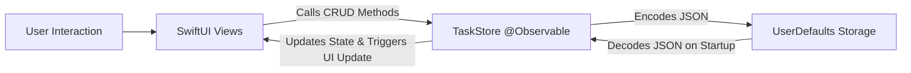

# 📘 MASTER PROJECT GUIDE & VIVA CHEAT SHEET
## Project Name: **MyWorkLog (InternTrack)**
> **One-Line Pitch:** A native, minimalist iOS mobile application built with SwiftUI designed for interns and working professionals to log daily tasks, monitor productivity metrics, manage deadlines on a calendar, and export work reports.

---

## 🎯 1. Executive Summary (Tell This First In Your Viva)
* **What is it?** A native iOS app developed completely in **Swift & SwiftUI** that helps students, interns, and employees maintain a clean daily record of work deliverables.
* **Why was it built?** In internships and corporate training, tracking what work was assigned, by whom, on which communication channel (e.g., WhatsApp, Email), and whether deliverables were submitted can get messy. This app centralizes task logging and tracks completion status.
* **Design Philosophy:** Minimalist, classic, and distraction-free iOS native interface following Apple Human Interface Guidelines (HIG).

---

## 🏗️ 2. Technical Stack & Architecture

| Component | Technology Used | Why We Used It |
|---|---|---|
| **Language** | Swift 5.0+ | Modern, strongly-typed, memory-safe compiled language for Apple platforms. |
| **UI Framework** | SwiftUI | Apple’s declarative modern UI framework (replaces older UIKit storyboard approach). |
| **State Management** | `@Observable` (Observation Framework) & `@Bindable` | Apple's modern observation system (iOS 17+) for lightweight reactive two-way data binding without boilerplate. |
| **Local Persistence** | `UserDefaults` + `JSONEncoder` / `JSONDecoder` (`Codable`) | Offline-first, fast local storage to save task logs, user profile, and activity history without needing complex external servers. |
| **Architecture Pattern** | MVVM-lite / Store Pattern | Clean separation between **Data Models** (`Models.swift`), **Business Logic & Storage** (`TaskStore.swift`), and **Presentation Views** (SwiftUI views). |
| **Build & Tooling** | Xcode, Git, GitHub | Industry-standard Apple IDE and version control. |

---

## 📂 3. Project File Structure & Responsibilities

```text
MyWorkLog/
├── MyApp.swift               --> App entry point (@main)
├── ContentView.swift         --> Root navigation (5-tab bar controller)
├── Models.swift              --> All data types, enums, and structures
├── TaskStore.swift           --> Central State Store & CRUD operations
├── DashboardView.swift       --> Screen 1: Overview metrics & recent updates
├── TaskListView.swift        --> Screen 2: Task list with search & filter
├── CalendarTasksView.swift   --> Screen 3: Graphical calendar & milestone agenda
├── ReportView.swift          --> Screen 4: Work report scope & export page
├── ProfileSettingsView.swift --> Screen 5: Intern details & data management
├── TaskEditorSheet.swift     --> Modal form for adding & editing tasks
├── TaskRowView.swift         --> Reusable task card component
└── PDFReportGenerator.swift  --> PDF drawing engine using UIGraphicsPDFRenderer
```

---

## 📱 4. Key App Modules & Features Explained Simply

### 1. Main Navigation (`ContentView.swift`)
- Implements a standard iOS **`TabView`** with 5 primary sections:
  1. **Dashboard** (Summary & Metrics)
  2. **Work Logs** (Task list with full CRUD, search & filters)
  3. **Calendar** (Calendar view with day-wise milestones)
  4. **Report** (Official report generation screen)
  5. **Profile** (Intern profile & data reset)

### 2. Dashboard (`DashboardView.swift`)
- **Header:** Displays intern's name, email, and a **"+ New Task"** quick button.
- **4 Metric Cards (Key Performance Indicators):**
  - **Total Tasks**
  - **Completed Tasks** (Green indicator)
  - **In Progress Tasks** (Blue indicator)
  - **Pending Tasks** (Orange indicator)
- **Tasks by Priority:** Real-time distribution breakdown across **Low**, **Medium**, and **High**.
- **Recent Updates:** Real-time activity log showing timestamps of recently performed actions.

### 3. Work Logs & Filtering (`TaskListView.swift`)
- **Full CRUD:** Create, Read, Update, and Delete tasks.
- **Dynamic Search Bar:** Live search using `.searchable` filtering by title, description, assigner, or deliverables notes.
- **Status Filter:** Segmented control for **All | Pending | Active | Completed**.
- **Category Filter:** Filter by **Documentation / PPT**, **Banner Design**, or **Others**.
- **Priority Filter:** Filter by **Low**, **Medium**, or **High**.
- **Gestures:**
  - **Tap row:** Opens edit sheet.
  - **Swipe left:** Destructive delete.
  - **Swipe right:** Cycle status (Pending ➔ In Progress ➔ Completed).

### 4. Task Creation & Editing (`TaskEditorSheet.swift`)
- Clean iOS Form containing:
  - Task Title & Assigner Name
  - **Platform Picker:** WhatsApp, Instagram, Email, Other
  - **Category Picker:** Documentation / PPT, Banner Design, Others
  - **Priority Segmented Control:** Low, Medium, High with clear label
  - **Status Picker:** Pending, In Progress, Completed
  - **Assigned Date & Deadline:** Native `DatePicker`
  - **Deliverable Notes / Proof:** Field for file links, pull requests, or deliverable descriptions.

### 5. Calendar & Milestones (`CalendarTasksView.swift`)
- Uses `.datePickerStyle(.graphical)` to show an interactive full-month calendar.
- Selecting any date filters tasks to show milestones, deadlines, and completed items for that specific date.

### 6. Formal Report Screen (`ReportView.swift`)
- Allows interns to choose report intervals: **This Month**, **Past 7 Days**, **All Time**, or a **Custom Range**.
- Contains the **"Export Official PDF Report"** button.

### 7. Profile & Settings (`ProfileSettingsView.swift`)
- **Intern Information:** Shows Full Name and Email Address.
  - Includes an **"Edit"** button. When clicked, reveals editable text fields with **"Save"** and **"Cancel"** options.
- **Internship Period:** Start Date and End Date.
- **Data Management:**
  - **"Reset All Data (Clear to 0)"**: Clears all tasks and logs to 0.
  - **"Restore Sample Tasks"**: Re-seeds default demo tasks anytime for demonstration purposes.

---

## 💡 5. Data Flow & State Management



- When a user adds, edits, or deletes a task, they call a method on `TaskStore`.
- Because `TaskStore` conforms to Swift's `@Observable`, SwiftUI automatically re-renders only the affected views.
- In `didSet`, `TaskStore` encodes the data model to JSON and stores it in `UserDefaults` for offline persistence.

---

## 🎓 6. VIVA VOCE QUESTIONS & READY-MADE ANSWERS

### Q1: What is the main objective of this project?
> **Answer:** "The objective is to provide a clean, native iOS application where interns can log daily assignments, track status and priorities, view upcoming deadlines on a calendar, and prepare structured work reports for their university mentors and company supervisors."

### Q2: Why did you choose SwiftUI over UIKit?
> **Answer:** "SwiftUI is Apple's modern declarative framework. It requires significantly less code, automatically manages state changes, uses responsive layout primitives like `VStack`, `HStack`, and `Form`, and integrates seamlessly with Swift's modern `@Observable` macro without requiring Storyboards or complex view controllers."

### Q3: How is data stored and persisted in this app?
> **Answer:** "We implemented an offline-first storage mechanism using **`UserDefaults`** combined with Swift's **`Codable` (`JSONEncoder` and `JSONDecoder`)**. Whenever tasks are modified, the store encodes the array into JSON and saves it locally. When the app opens, it decodes the data back into native Swift struct models."

### Q4: How is state managed across multiple screens?
> **Answer:** "We use the modern **`Observation` framework** with an `@Observable` class called `TaskStore`. A single instance is initialized in the root `ContentView` and passed down to child views using `@Bindable`. When any property inside `TaskStore` changes, SwiftUI automatically updates all screens that depend on that property."

### Q5: What platforms and categories does the app track?
> **Answer:**
> * **Platforms:** WhatsApp, Instagram, Email, Other (channels where tasks are assigned).
> * **Categories:** Documentation / PPT, Banner Design, Others (types of assignments).
> * **Priorities:** Low, Medium, High.
> * **Statuses:** Pending, In Progress, Completed.

### Q6: How does the Reset button work in Settings?
> **Answer:** "The `resetAllData()` function in `TaskStore` empties the `tasks` and `activityLogs` arrays and overwrites `UserDefaults` with empty JSON arrays. As a result, all counters on the dashboard (Total, Completed, In Progress, Pending) instantly reset to 0. We also included a confirmation alert to prevent accidental data deletion, as well as a 'Restore Sample Tasks' option for demonstration."

### Q7: How does the Calendar view link with tasks?
> **Answer:** "The calendar view binds to a selected `Date`. It filters the entire task array in real-time to match either the assigned date, completion date, or deadline with the selected calendar day, displaying day-specific agenda items below the calendar."

### Q8: What design pattern did you follow?
> **Answer:** "We followed the **Store / MVVM-lite pattern**. `Models.swift` acts as the Model, `TaskStore.swift` acts as the ViewModel/Store containing all business logic and storage methods, and SwiftUI files like `DashboardView` and `TaskListView` act as declarative Views."

---

## ⚡ 7. Quick 30-Second Demo Script for Viva / Presentation
1. **Show Dashboard:** *"Here on the Dashboard, you can see live summary cards: Total, Completed, In Progress, and Pending tasks, along with priority distribution and recent activity updates."*
2. **Add a Task:** *"I'll tap '+ New Task', title it 'Prepare PPT Presentation', select category 'Documentation / PPT', platform 'WhatsApp', priority 'High', and click Save."*
3. **Show List & Filter:** *"In the Work Logs tab, our new task appears immediately. We can search for it in real-time or filter by Active or Completed status, or swipe to cycle its status."*
4. **Show Calendar:** *"In the Calendar tab, selecting today highlights our scheduled task under day milestones."*
5. **Show Profile & Settings:** *"In Profile & Settings, we can tap 'Edit' to update our name and email with Save/Cancel controls, or tap 'Reset All Data' to clear all metrics to 0."*
